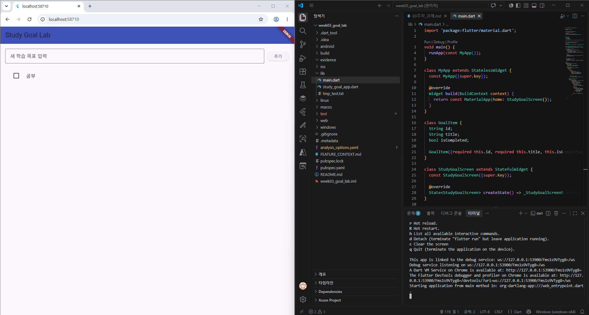
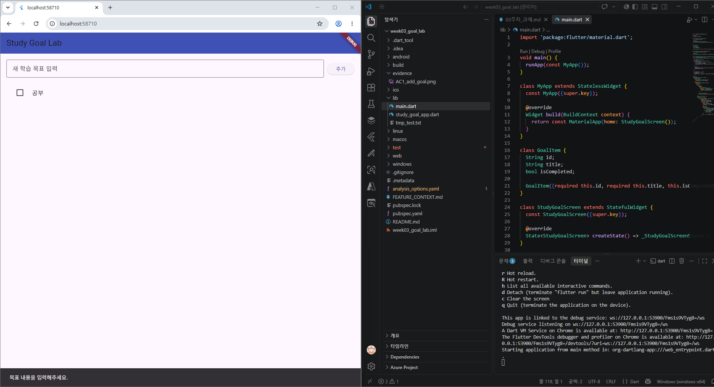
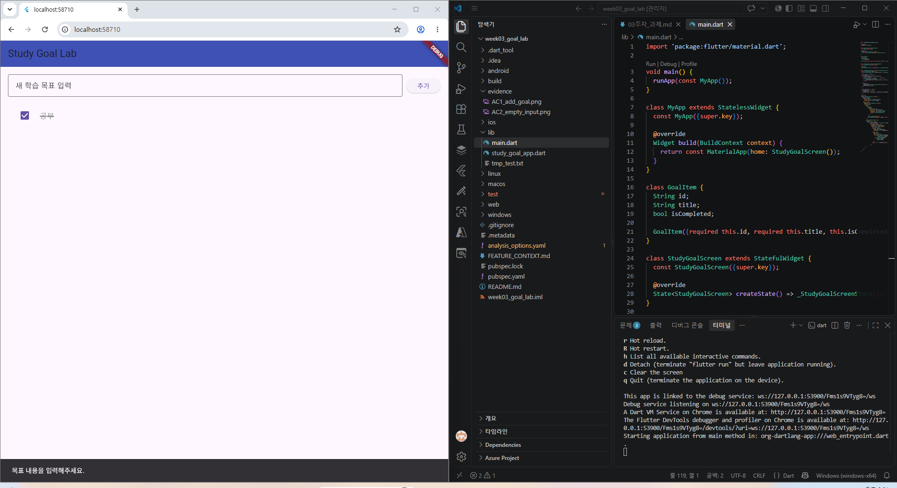

# 📝 Week 03 Evidence Pack: StudyGoal 기능 요구사항 명세서

* **제출자:** 강명진 (2023136068)
* **제출일:** 2026년 9월15일
* **저장소:** https://github.com/2023136068-ai/week03_goal_lab

---

## 1. 사용자 목표와 스토리

* **기능 이름:** StudyGoal 추가·완료 전환
* **대상 사용자:** 주차별 학습 목표를 스스로 등록하고 완료 여부를 관리하고 싶은 학생
* **사용자가 해결하려는 문제:** 머릿속으로만 기억하던 학습 목표를 시각적 목록으로 관리하고, 완료한 항목을 체크하여 학습 달성도를 직관적으로 파악하고자 함
* **사용자 스토리:**
  > "학생 사용자로서, 주차별 공부 목표를 앱에 직접 등록하고 완료 시 탭하여 체크 표시로 전환하기를 원한다. 그래서 오늘 달성해야 할 목표를 놓치지 않고 명확히 확인하여 학습 효율을 높일 수 있다."

---

## 2. 기능 범위와 제약

| 항목 | 필수 내용 |
|---|---|
| **포함 범위** | 1. 텍스트 입력창을 통한 새로운 학습 목표 생성 (`_addGoal`) 2. 등록된 목표 항목 탭 시 완료 상태 토글 (`_toggleGoal`) 3. 완료된 항목에 대한 시각적 구별 처리 (취소선 및 체크박스 활성화) |
| **제외 범위** | 1. 데이터의 로컬/서버 데이터베이스 영구 저장 (앱 재시작 시 초기화 허용) 2. 등록된 목표의 수정 및 삭제 기능 3. 카테고리 분류, 날짜별 필터링 및 통계 그래프 기능 |
| **입력** | 사용자가 입력 폼(`TextField`)에 작성하는 목표 텍스트 문자열 |
| **출력** | `ListView`에 추가되는 `GoalItem` 위젯, 완료 여부(`isCompleted`) 상태값 변화 |
| **예외** | 빈 문자열 또는 공백만 입력 후 등록 시도 시 목록 추가 방지 및 스낵바 경고 메시지 출력 |
| **UI 제약** | 완료된 목표는 텍스트 취소선(`TextDecoration.lineThrough`)과 회색 톤(`Colors.grey`)을 적용해 비완료 상태와 명확히 구분 |

---

## 3. 수용조건과 완료 증거

### AC1: 정상 입력과 정상 결과
* **Given:** 사용자가 목표 입력창에 `"Flutter 3주차 실습 완료"`를 입력하고
* **When:** '추가' 버튼을 누르면
* **Then:** 목록 맨 아래에 `"Flutter 3주차 실습 완료"` 항목이 미완료 상태로 새로 추가된다.
* **실행 증거:**
  

### AC2: 빈 값 예외 처리 결과
* **Given:** 사용자가 입력창을 비워둔 상태에서
* **When:** '추가' 버튼을 누르면
* **Then:** 목표 목록에 변화가 없으며, 빈 값 등록을 방지하고 경고 메시지를 표시한다.
* **실행 증거:**
  

### AC3: 상태 변경 결과
* **Given:** 목록에 미완료 상태인 `"Flutter 3주차 실습 완료"` 항목이 존재할 때
* **When:** 해당 항목 또는 체크박스를 탭하면
* **Then:** 항목의 체크박스가 활성화되고 텍스트에 취소선이 적용되며 완료 상태로 바뀐다.
* **실행 증거:**
  

---

## 4. 구현과 Git 기록

* **본인 GitHub 저장소 링크:** https://github.com/2023136068-ai/week03_goal_lab
* **커밋 메시지:** `feat: implement StudyGoal acceptance criteria`